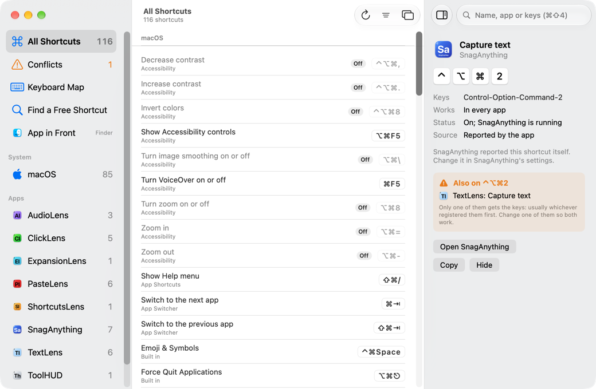
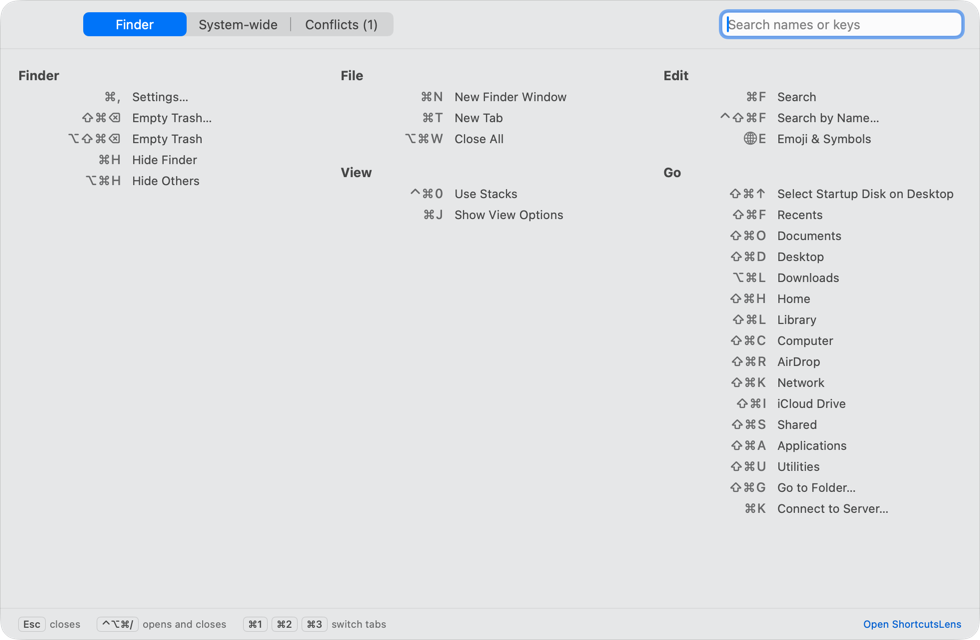
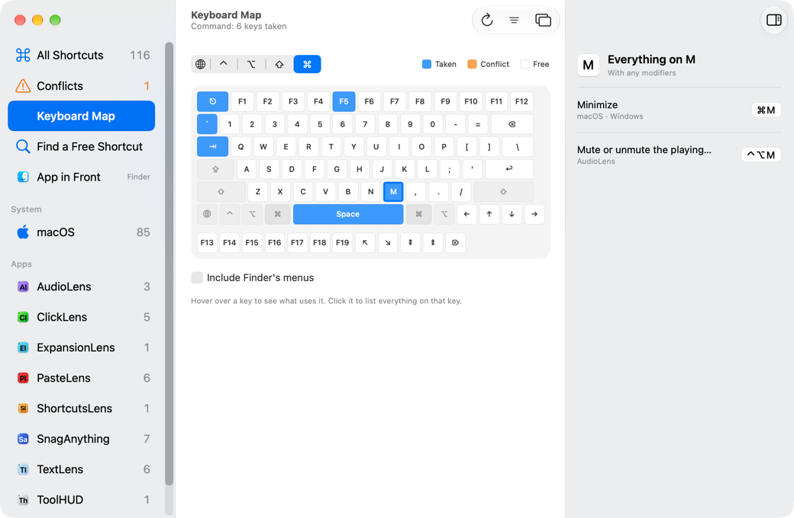
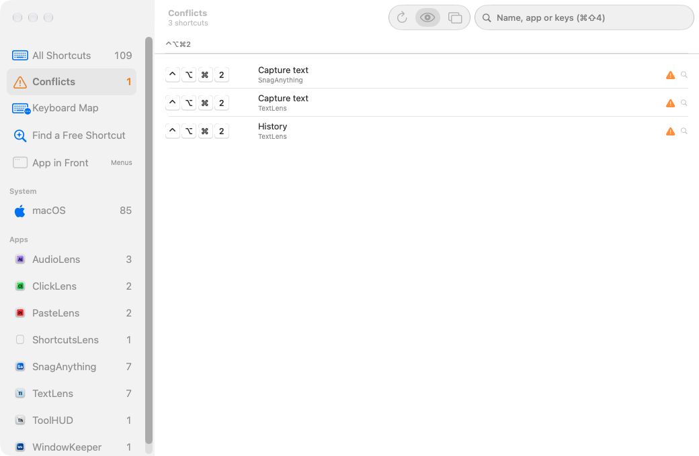
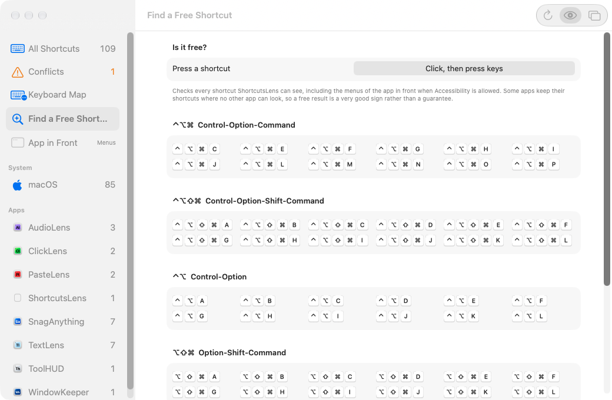
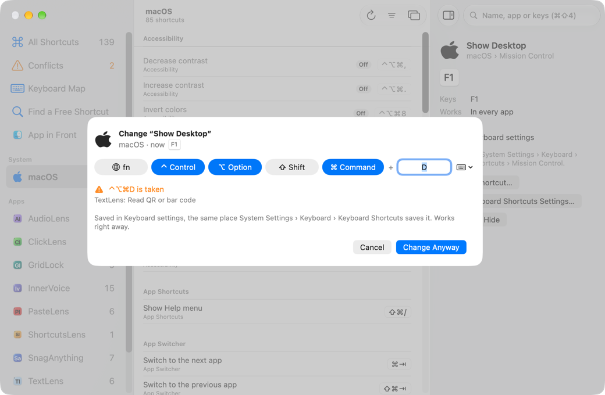

# ShortcutsLens

**See every keyboard shortcut that works everywhere on your Mac, which app it belongs to, and which ones collide.**

Global shortcuts pile up. macOS has dozens, every menu bar utility adds a few more, and nothing shows them all in one place. When two apps want the same keys, one of them silently stops working, and when you pick a new shortcut you're guessing whether it's free. ShortcutsLens gathers macOS's shortcuts, Services, App Shortcuts and the global shortcuts your apps register into one searchable list, flags the conflicts, draws a keyboard of what's taken, and puts a cheat sheet for the app you're using one keystroke away.

<p align="center"></p>

## Download

### [⬇︎ Download ShortcutsLens.dmg](https://github.com/smanke-org/ShortcutsLens/releases/latest/download/ShortcutsLens.dmg)

1. Open the downloaded **ShortcutsLens.dmg**.
2. Drag **ShortcutsLens** onto the **Applications** folder.
3. Open ShortcutsLens from Applications. It needs no permission to list shortcuts. To read the menus of the app you're using, allow **Accessibility** when it asks.

Requires macOS 26 or later. ShortcutsLens is in beta.

## What it does

- **Every system-wide shortcut, by app.** macOS's own (named and grouped as in Keyboard settings, with the values macOS is actually using), fixed ones like Force Quit and the 🌐 key's, Services, App Shortcuts, the global shortcuts apps save in their settings, and the documented defaults of popular apps that never save theirs.
- **Conflicts.** Shortcuts that are on and share the same keys, grouped by keys, with where to change each one.
- **Change a shortcut right there.** Give macOS's own shortcuts, App Shortcuts, and shortcuts from apps that support it new keys from the inspector, with a conflict check before you save and Undo afterward.
- **Keyboard Map.** Your keyboard for any mix of modifiers: taken keys lit, conflicts in orange, free keys plain. Click a key to see everything on it.
- **Find a Free Shortcut.** Choose the modifier keys and type the key of a shortcut you have in mind to see which app, if any, uses it (and move that shortcut to other keys with Change…), or pick from free ones in the modifier sets least likely to clash with app menus. Click to copy.
- **The app in front.** With Accessibility, the menu shortcuts of the app you were using, with where each sits in its menus.
- **Quick View.** ⌃⌥⌘/ (change it in Settings) floats a cheat sheet over any app: its menu shortcuts, every system-wide shortcut and the conflicts, searchable. Optionally hold ⌘ for a second to peek at it.
- **Search by name or keys.** Type ⌘⇧4 or ⇧⌘4, either finds it.
- **Hide what you don't need.** Right-click a shortcut or an app to hide it; Settings › Sources brings them back.
- **Dock, menu bar, both or neither,** with ToolHUD menu support, light and dark appearance, and iCloud settings sync.

## Screenshots

<table>
<tr>
<td width="50%"><br><sub><b>Quick View.</b> A cheat sheet over any app, one shortcut away.</sub></td>
<td width="50%"><br><sub><b>Keyboard Map.</b> What's taken for each set of modifiers.</sub></td>
</tr>
<tr>
<td width="50%"><br><sub><b>Conflicts.</b> Shortcuts that fight over the same keys.</sub></td>
<td width="50%"><br><sub><b>Find a Free Shortcut.</b> Check one, or pick one that's free.</sub></td>
</tr>
<tr>
<td width="50%"><br><sub><b>Change Shortcut.</b> New keys, checked for conflicts before you save.</sub></td>
<td width="50%"></td>
</tr>
</table>

## How it works

macOS keeps no single list of every shortcut, and it doesn't tell one app which keys another has registered. ShortcutsLens reads what can be read:

- **macOS's shortcuts** come from the table Keyboard settings is built from, merged with your changes (`com.apple.symbolichotkeys`) and the live values the window server is using.
- **Apps' shortcuts** come from their settings files. Most apps save global shortcuts with one of a few common libraries, and each leaves a recognizable shape (a JSON string of key code and modifiers, an archived shortcut object, a key-code dictionary). ShortcutsLens only looks under settings whose names say "hotkey" or "shortcut", so window positions and typed keys aren't mistaken for shortcuts.
- **Apps that report their own shortcuts** answer ShortcutsLens directly while they run, which is exact. The protocol is one small file, [`Shared/ShortcutsLensReport.swift`](Shared/ShortcutsLensReport.swift), that any app can copy in. An app that passes a `change` handler to it also lets people give its shortcuts new keys from ShortcutsLens.
- **Popular apps that never save their defaults** (Snagit, 1Password, Clop and a few more) are covered by a short list of their documented default shortcuts, used only when nothing is found in the app's settings.
- **App Store apps** keep their settings in a sandbox. Turn on "Also look in sandboxed apps" in Settings › Sources to include them; macOS asks once whether ShortcutsLens may see other apps' data.

An app that keeps its shortcuts in its own database, or hard-codes them, leaves nothing to read, so a shortcut ShortcutsLens calls free is a very good sign rather than a guarantee. ShortcutsLens never writes another app's settings file: it changes macOS's shortcuts and App Shortcuts where System Settings keeps them, and other apps' shortcuts only by asking the app, which saves the change itself. It never asks for Full Disk Access.

## Updates

ShortcutsLens checks GitHub for new versions once a day (change how often, or turn it off, in Settings › Updates). It can ask first or install automatically. Automatic installs wait until the Quick View is closed and your Mac is idle, and every download must be signed by the same developer and notarized by Apple before it's installed.

## Automation

`shortcutslens://open`, `shortcutslens://quickview`, `shortcutslens://conflicts`, `shortcutslens://keyboard`, `shortcutslens://free` and `shortcutslens://settings` open those pages, for ToolHUD buttons, Shortcuts and scripts.

### Command line and AI agents

ShortcutsLens is also a command line tool, so scripts and AI agents (Claude Code, Codex) can search your shortcuts
by app, keys or source, list the conflicts, check whether a key combination is free, suggest free ones, and hide
shortcuts from the lists. Commands run in the open app, so the answers match what the window shows. Link it once
to type `shortcutslens`:

```bash
ln -s /Applications/ShortcutsLens.app/Contents/MacOS/ShortcutsLens ~/.local/bin/shortcutslens
```

```bash
shortcutslens help
shortcutslens shortcuts list --search screenshot --json
shortcutslens keys check "ctrl+opt+cmd+k"
shortcutslens conflicts list --app "Example App"
```

Every command takes `--json`. For MCP apps such as Claude Desktop, the same commands are served by
`/Applications/ShortcutsLens.app/Contents/MacOS/ShortcutsLens mcp`:

```bash
claude mcp add --scope user shortcutslens -- /Applications/ShortcutsLens.app/Contents/MacOS/ShortcutsLens mcp
```

## Building

```bash
swift test          # the ShortcutsLensKit tests
./build_app.sh      # signed universal app in .build/app
./install.sh        # copy to /Applications and open
./release.sh 1.0.1  # notarized DMG and GitHub release
```

Signing uses the Developer ID identity in your keychain; notarization uses a `notarytool` keychain profile.

## License

© 2026 Steve Manke. All rights reserved.
